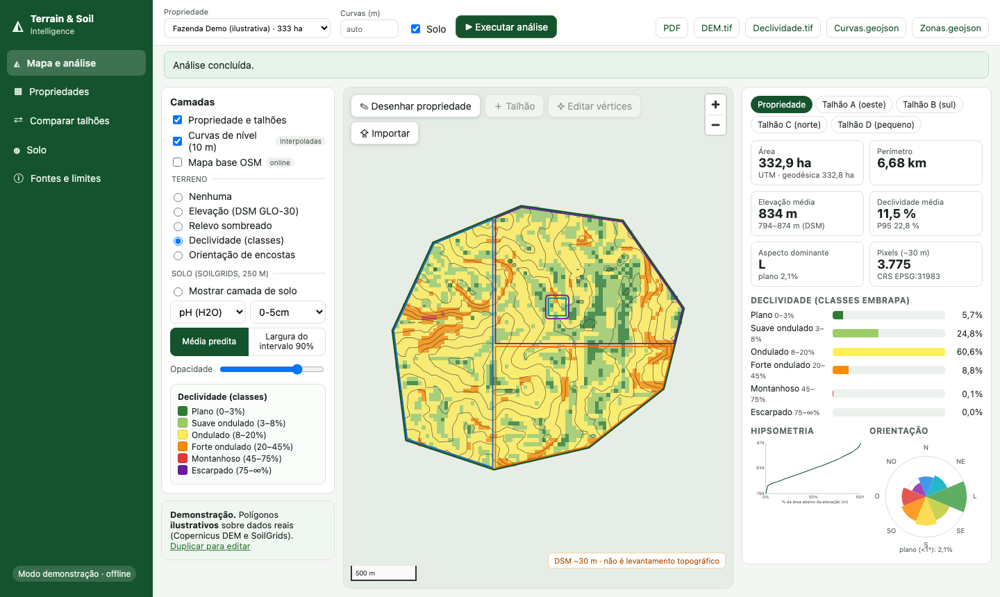

# Project 03 · Terrain & Soil Intelligence

[🇧🇷 Português](README.md) · 🇺🇸 English

A web platform for **terrain and soil analysis of agricultural properties**: draw or import a boundary (GeoJSON, KML, zipped Shapefile) and get area, perimeter, elevation, slope, aspect, hypsometry, contour lines and estimated soil attributes, with interactive maps, plot comparison, GeoTIFF/GeoJSON export and a **PDF report that includes methodology, sources and limitations**.

**Stack:** FastAPI · Shapely · GeoPandas · Rasterio · rasterstats · PostGIS (SQLite in demo) · React + TypeScript · MapLibre GL JS · Docker Compose · pytest · Playwright.



> ### ⚠️ Read before use
> - **Copernicus DEM GLO-30 is a DSM** (a *surface* model that includes canopy and buildings) with **~30 m** cells. It is **not a topographic survey**: it cannot map micro-relief or be used to plan safe sprayer/machinery paths.
> - Contour lines are **interpolated** from the DSM, **not** field measurements.
> - **SoilGrids** is a **model prediction** at 250 m with very wide 90% intervals (in the demo, clay 37.8% **[5.8–79.9]**), so the app does not claim soil differences between plots.
> - The app does **not estimate** compaction, actual fertility, fertiliser requirements, traffic safety or rollover risk: these need field data and expert validation.
> - Demo-mode polygons are **fictitious** (drawn over real data).

> The UI, notebooks and `docs/pt-BR/` are in Portuguese; this README summarises the project.

## Delivered and verified
| Requirement | Status |
|---|---|
| Draw, edit, import polygons (GeoJSON, KML, zipped Shapefile) | ✅ unit + E2E tests (real mouse drawing) |
| Validate geometry, CRS, intersections, invalid polygons | ✅ repair with warning, UTM-in-GeoJSON rejected, overlapping/outside plots |
| Area (ha), perimeter, centroid, bbox in a suitable projection | ✅ SIRGAS 2000/UTM + geodesic cross-check (332.86 vs 332.85 ha) |
| Copernicus GLO-30 DEM, clipped to the polygon | ✅ live (AWS COG) and offline sample; identical |
| Elevation, slope, aspect, hypsometry, contours coherent with resolution | ✅ validated on analytic surfaces (0.002% error); interval < 5 m rejected |
| SoilGrids (pH, carbon, clay, silt, sand), documented depth/units | ✅ with per-pixel 90% interval; failure isolated if the source is down |
| Interactive maps, layers, legend, scale, charts, per-plot statistics | ✅ screenshots in `docs/screenshots/` |
| Export GeoTIFF/GeoJSON and PDF with methodology, sources, limitations | ✅ tested |
| PostGIS storage | ⚠️ **code written, NOT executed** (no Docker here); SQLite tested |
| Async jobs with progress | ✅ monotonic progress tested |
| Offline demo mode | ✅ **real** clips versioned (≈ 860 KB) |
| Docker Compose | ⚠️ **syntax validated, NOT executed** |

## Quick start (offline demo)
```bash
make install && cp .env.example .env     # TSI_MODE=demo
make api      # http://localhost:8000/docs
make web      # http://localhost:5173
```
Pick **Fazenda Demo (ilustrativa)** → **▶ Executar análise**. For **live** mode (anywhere in Brazil, needs internet) set `TSI_MODE=live`. Docker: `docker compose up --build` (untested, see above).

## Demo results (real data, fictitious polygon)
A **332.86 ha** property near Espírito Santo do Pinhal (SP, Brazil): DSM elevation **794–874 m** (mean 834), mean slope **11.5%** (P95 22.8%), 60.6% of the area in the *Ondulado* class (8–20%), dominant aspect East with every orientation present. Soil (0–5 cm): clay **37.8% [5.8–79.9]**, pH **5.3 [4.3–6.7]**, organic carbon **29.5 g/kg [5.3–73.6]**. Plot comparison: every soil difference is **within the uncertainty**.

## Key methodological findings
- **Resolution dominates** slope: aggregating the real DEM from 30 m to 150 m drops mean slope from 14.2% to 8.7% (notebook 01).
- Spatial variation of the predicted soil mean inside the property is ≈ **3.6%** of the 90% interval width (median, notebook 03): soil maps show model structure, not measured differences.
- ISRIC's `uncertainty` layer ≈ 10 × (Q0.95 − Q0.05)/Q0.50 (r = 0.955, 68 pixels). The official docs were down, so the definition is unconfirmed and the app uses the quantiles directly.

## Source and dependency status (2026-10-31)
| Item | Status |
|---|---|
| Copernicus DEM (AWS) | ✅ working |
| SoilGrids COG (`files.isric.org`) | ✅ working |
| SoilGrids REST (`rest.isric.org`) | ❌ 503 — not used |
| ISRIC docs (`docs.isric.org`) | ❌ 502 — units and `uncertainty` verified from the data |
| DEM datum/accuracy | ⚠️ secondary sources (Handbook only as table of contents) |
| PostGIS, Docker Compose | ⚠️ not executed |

## Tests
`pytest tests -q` → **63 passed** · with network **65** · E2E (Chromium) **13** · frontend **5** · 3 executed notebooks. **Not validated:** DEM accuracy against ground truth, PostGIS (see `docs/pt-BR/12_testes_e_validacao.md`).

## Licences
Code: **GPL-3.0** (see `LICENSE`). Data: Copernicus DEM (Copernicus licence, cite the source) and SoilGrids (CC BY 4.0). Redistribution terms of the Copernicus clips were **not legally reviewed** — see [sample_data/ATTRIBUTION.md](sample_data/ATTRIBUTION.md).

## Repository, versioning and running on another machine

Published from the original development machine (macOS, Podman). This has **not** been run on GitHub Codespaces or Docker Desktop; if you run it there, treat it as a first verification and compare with the tests section.

- **Versioned:** `backend/`, `frontend/`, `scripts/`, notebooks, tests, `docs/pt-BR/` and `sample_data/` (demo clips; attribution in `sample_data/ATTRIBUTION.md`). `demo` mode (default in `.env.example`) reads only `sample_data/` and runs offline.
- **Not versioned:** `data/` (live-mode download cache and the runtime SQLite), `.env`, `node_modules/`.
- **Not validated:** `docker-compose.yml` and PostGIS were written but **never executed** on the dev machine (see the warning at the top); DEM accuracy was not checked against GNSS.
- **Code licence:** GPL-3.0 (`LICENSE`). Third-party data/model licences and attributions: see the sections and docs above.
