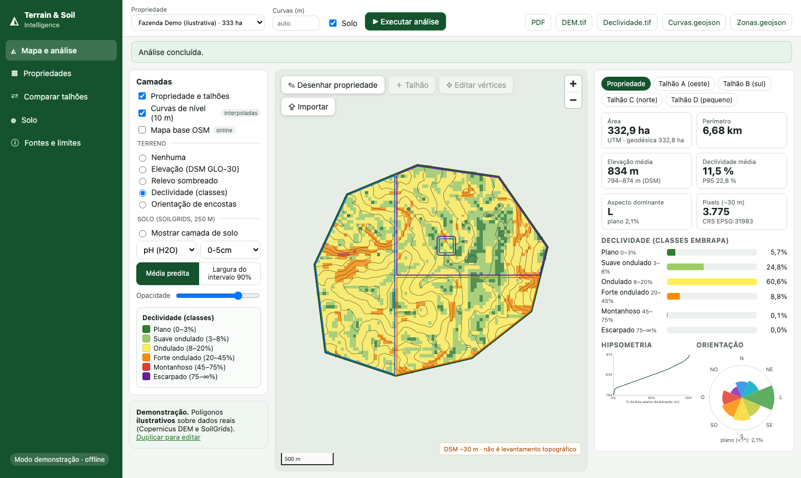

# Projeto 03 · Terrain & Soil Intelligence

🇧🇷 Português · [🇺🇸 English](README.en.md)

Plataforma web para **análise territorial de propriedades agrícolas**: desenhe ou importe o perímetro (GeoJSON, KML, Shapefile ZIP) e receba área, perímetro, elevação, declividade, orientação das encostas, hipsometria, curvas de nível e atributos de solo estimados, com mapas interativos, comparação de talhões, exportação (GeoTIFF/GeoJSON) e **relatório PDF com metodologia, fontes e limitações**.

**Stack:** FastAPI · Shapely · GeoPandas · Rasterio · rasterstats · PostGIS (SQLite no demo) · React + TypeScript · MapLibre GL JS · Docker Compose · pytest · Playwright.



> ### ⚠️ Leia antes de usar
> - O **Copernicus DEM GLO-30 é um DSM** (modelo de *superfície*, inclui copas e construções), com célula de **~30 m**. **Não é levantamento topográfico**: não mapeia microdesníveis nem serve para planejar trajetórias de pulverizadores ou máquinas.
> - Curvas de nível são **interpoladas** do DSM, **não** medidas de campo.
> - O **SoilGrids** é uma **predição de modelo** a 250 m, com intervalos de 90% muito largos (na demonstração, argila 37,8% **[5,8–79,9]**). Por isso o app não afirma diferenças de solo entre talhões.
> - O app **não estima** compactação, fertilidade real, necessidade de adubação, risco de tráfego ou de tombamento: isso exige dados de campo e validação especializada.
> - Os polígonos do modo demonstração são **fictícios** (sobre dados reais).

## O que foi entregue e verificado

| Requisito | Estado |
|---|---|
| Desenhar, editar e importar polígonos (GeoJSON, KML, Shapefile ZIP) | ✅ testado (unidade + E2E com mouse real) |
| Validar geometria, CRS, interseções, polígonos inválidos | ✅ reparo com aviso, recusa de UTM em GeoJSON, talhões sobrepostos/fora |
| Área (ha), perímetro, centroide, bbox em projeção adequada | ✅ SIRGAS 2000/UTM + conferência geodésica (332,86 × 332,85 ha) |
| DEM Copernicus GLO-30, recorte ao polígono | ✅ ao vivo (AWS COG) e amostra offline; idênticos |
| Elevação, declividade, aspecto, hipsometria, curvas coerentes com a resolução | ✅ validado contra superfícies analíticas (erro 0,002%); intervalo < 5 m recusado |
| SoilGrids (pH, carbono, argila, silte, areia) com profundidade/unidade documentadas | ✅ com intervalo de 90% por pixel; falha isolada se a fonte cair |
| Mapas interativos, camadas, legenda, escala, gráficos, estatísticas por talhão | ✅ capturas em `docs/screenshots/` |
| Exportar GeoTIFF/GeoJSON e PDF com metodologia, fontes e limitações | ✅ testado (GeoTIFF abre no rasterio; PDF com seções obrigatórias) |
| Armazenar em PostGIS | ⚠️ **código escrito, NÃO executado** (sem Docker aqui); SQLite testado |
| Jobs assíncronos com progresso | ✅ progresso monotônico testado |
| Modo demonstração offline | ✅ recortes **reais** versionados (≈ 860 KB) |
| Docker Compose | ⚠️ **sintaxe validada, NÃO executado** |

## Início rápido (demonstração offline, sem internet)
```bash
make install                      # venv + npm install
cp .env.example .env              # TSI_MODE=demo
make api                          # terminal 1 → http://localhost:8000/docs
make web                          # terminal 2 → http://localhost:5173
```
Selecione **Fazenda Demo (ilustrativa)** → **▶ Executar análise**. Modo **live** (qualquer local do Brasil, precisa de internet): `TSI_MODE=live`. Docker: `docker compose up --build` (veja o aviso acima). Passo a passo em [docs/pt-BR/11_tutoriais.md](docs/pt-BR/11_tutoriais.md).

## Resultados da demonstração (real, sobre polígono fictício)
Propriedade de **332,86 ha** em Espírito Santo do Pinhal (SP): elevação do DSM **794–874 m** (média 834), declividade média **11,5%** (P95 22,8%), 60,6% da área na classe *Ondulado* (8–20%); aspecto dominante Leste, com todas as orientações presentes. Solo (0–5 cm): argila **37,8% [5,8–79,9]**, pH **5,3 [4,3–6,7]**, carbono **29,5 g/kg [5,3–73,6]**. Comparação de talhões: todas as diferenças de solo ficam **dentro da incerteza**.

## Principais achados metodológicos
- A **resolução domina** a declividade: agregando o DEM real de 30 m para 150 m, a média cai de 14,2% para 8,7% (notebook 01).
- Variação espacial da média do solo dentro da propriedade ≈ **3,6%** da largura do intervalo de 90% (mediana, notebook 03): os mapas de solo mostram estrutura do modelo, não diferenças medidas.
- A camada `uncertainty` do ISRIC ≈ 10 × (Q0.95 − Q0.05)/Q0.50 (r = 0,955, 68 pixels); como a documentação oficial estava fora do ar, a definição não está confirmada e o app usa os quantis diretamente.

## Status das fontes e dependências (31/10/2026)
| Item | Estado |
|---|---|
| Copernicus DEM (AWS) | ✅ funcionando |
| SoilGrids COG (`files.isric.org`) | ✅ funcionando |
| SoilGrids REST (`rest.isric.org`) | ❌ 503 — não usada |
| Docs do ISRIC (`docs.isric.org`) | ❌ 502 — unidades e `uncertainty` verificadas nos dados |
| Datum/exatidão do DEM | ⚠️ fontes secundárias (Handbook só índice) |
| PostGIS, Docker Compose | ⚠️ não executados |

## Testes
`pytest tests -q` → **63 passaram** · com rede **65** · E2E (Chromium) **13** · frontend **5** · 3 notebooks executados. Detalhes, bugs encontrados e **o que não foi validado** (exatidão do DEM contra o terreno, PostGIS) em [docs/pt-BR/12_testes_e_validacao.md](docs/pt-BR/12_testes_e_validacao.md).

## Estrutura
```
backend/app/      API FastAPI e núcleo geoespacial (core/)
frontend/src/     React + TypeScript + MapLibre
infra/            Dockerfiles, nginx, init.sql
tests/            unidade, API e e2e/ (Playwright)
sample_data/      recortes reais (DEM, SoilGrids) + polígonos fictícios + arquivos inválidos
notebooks/        01 terreno · 02 DEM real · 03 SoilGrids (executados)
docs/pt-BR/       00–13: geodésia, CRS, raster/vetor, DSM, declividade, interpolação, solo, interpretação, API…
docs/openapi.json documentação OpenAPI · docs/screenshots/  capturas da interface
scripts/          dados de amostra, notebooks, OpenAPI, checagem da infra
```

## Documentação
[00 Guia de estudo](docs/pt-BR/00_guia_de_estudo.md) · [01 Arquitetura](docs/pt-BR/01_arquitetura.md) · [02 Geodésia](docs/pt-BR/02_geodesia.md) · [03 CRS](docs/pt-BR/03_crs_e_projecoes.md) · [04 Raster e vetor](docs/pt-BR/04_raster_vetor.md) · [05 DEM/DSM/DTM](docs/pt-BR/05_dem_dsm_dtm.md) · [06 Declividade e aspecto](docs/pt-BR/06_declividade_e_aspecto.md) · [07 Interpolação e curvas](docs/pt-BR/07_interpolacao_e_curvas_de_nivel.md) · [08 Solo](docs/pt-BR/08_propriedades_do_solo.md) · [09 Interpretação](docs/pt-BR/09_interpretacao_de_resultados.md) · [10 API](docs/pt-BR/10_api.md) · [11 Tutoriais](docs/pt-BR/11_tutoriais.md) · [12 Testes](docs/pt-BR/12_testes_e_validacao.md) · [13 Limitações e licenças](docs/pt-BR/13_limitacoes_e_licencas.md)

## Licenças
Código: **GPL-3.0** (arquivo `LICENSE`). Dados: Copernicus DEM (Licença Copernicus, citar fonte) e SoilGrids (CC BY 4.0). Os termos de redistribuição dos recortes do Copernicus **não foram revisados juridicamente** — [sample_data/ATTRIBUTION.md](sample_data/ATTRIBUTION.md).

## Repositório, versionamento e execução em outra máquina

Código publicado a partir da máquina de desenvolvimento original (macOS, Podman). Isto **não** foi executado em GitHub Codespaces nem em Docker Desktop; se rodar lá, trate como primeira verificação e compare com a seção de testes.

- **Versionado:** `backend/`, `frontend/`, `scripts/`, notebooks, testes, `docs/pt-BR/` e `sample_data/` (recortes de demonstração; atribuição em `sample_data/ATTRIBUTION.md`). O modo `demo` (padrão do `.env.example`) lê só de `sample_data/` e roda offline.
- **Não versionado:** `data/` (cache de downloads do modo `live` e o SQLite criado em execução), `.env`, `node_modules/`.
- **Não validado:** `docker-compose.yml` e PostGIS foram escritos mas **não foram executados** nesta máquina (veja o aviso no início do README); a exatidão do DEM não foi validada contra GNSS.
- **Licença do código:** GPL-3.0 (arquivo `LICENSE`). Licenças e atribuições de dados/modelos de terceiros: veja as seções e docs indicados acima.
