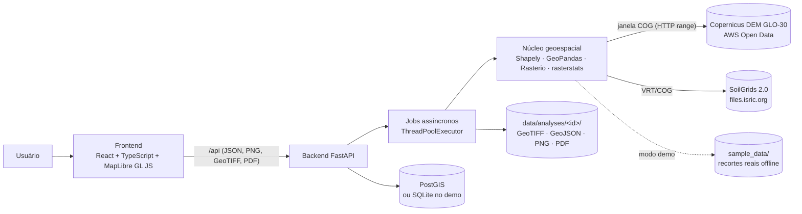
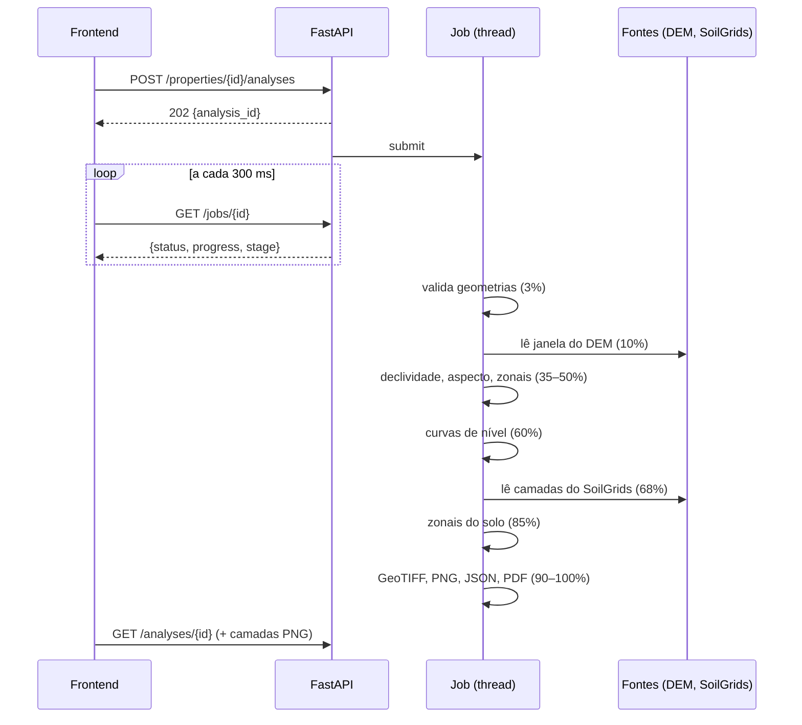
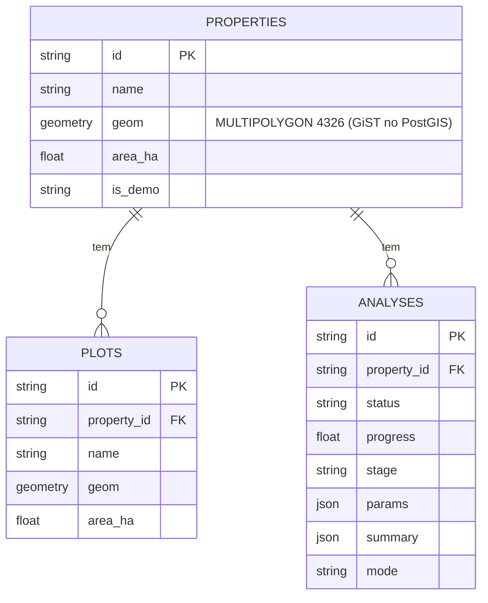

# 01 · Arquitetura

## Visão geral

## Componentes
| Pasta | Conteúdo |
|---|---|
| `backend/app/main.py` | rotas FastAPI, validação de entrada, exportações |
| `backend/app/core/geometry.py` | validação, escolha de UTM, área/perímetro/centroide/bbox, talhões |
| `backend/app/core/io.py` | GeoJSON, KML (lxml seguro), Shapefile ZIP |
| `backend/app/core/dem.py` | tiles do Copernicus (COG remoto), cache, modo demo |
| `backend/app/core/terrain.py` | Horn, aspecto, hipsometria, *hillshade*, classes |
| `backend/app/core/contours.py` | curvas de nível e política de intervalo |
| `backend/app/core/soil.py` | SoilGrids, conversões, textura USDA |
| `backend/app/core/zonal.py` | estatísticas zonais com avisos de qualidade |
| `backend/app/core/analysis.py` | orquestra a análise e grava os artefatos |
| `backend/app/core/render.py` | PNG das camadas e legendas |
| `backend/app/core/report.py` | PDF |
| `backend/app/store.py` | SQLAlchemy (PostGIS/SQLite) · `jobs.py` jobs |
| `frontend/src` | `App.tsx` + `components/` (mapa, painéis, gráficos SVG, diálogos) |
| `infra/` | Dockerfiles, nginx, `init.sql` |

## Fluxo de uma análise (job assíncrono)

O progresso é gravado na tabela `analyses` (`status`, `progress`, `stage`), portanto qualquer réplica da API enxerga o estado. Se uma etapa **opcional** (solo) falha, a análise termina com **aviso explícito**; se uma etapa essencial (DEM) falha, o job vira `failed` com a mensagem.

## Modelo de dados

Os rasters e os resultados detalhados ficam em `data/analyses/<id>/` (não no banco): `results.json`, `dem_clip.tif`, `slope_deg.tif`, `aspect_deg.tif`, `contours.geojson`, `property.geojson`, `layers.npz`, `soil.npz`, `relatorio.pdf`.

**PostGIS × SQLite:** o tipo `GeomType` grava `geometry(MULTIPOLYGON, 4326)` no PostgreSQL (índice espacial GiST criado pelo GeoAlchemy2) e GeoJSON em texto no SQLite. O código do PostGIS **não foi executado** nesta máquina (veja `12_testes_e_validacao.md`).

## Decisões de projeto
| Decisão | Motivo |
|---|---|
| Não reprojetar o DEM; dx/dy por latitude | evita interpolar a elevação antes de derivar declividade |
| Medir área em UTM e conferir no elipsoide | rigor + autoverificação |
| Camadas como PNG + `image` source no MapLibre | leve, funciona offline, fácil legenda; não é tile pyramid |
| `ThreadPoolExecutor` em vez de Celery | análise de uma propriedade leva segundos; menos peças. Se a carga crescer: fila externa |
| Solo opcional e com falha isolada | SoilGrids pode estar fora do ar (a REST estava em 503) |
| Avisos de qualidade no resultado (`quality_flags`) | números sem aviso de representatividade enganam |
| Faixas **fixas** nas legendas de solo | autoescala faria diferenças ínfimas parecerem grandes |
| Mapa de cores `cividis` para elevação | `terrain` tem degrau de cor que parece uma borda no relevo |
