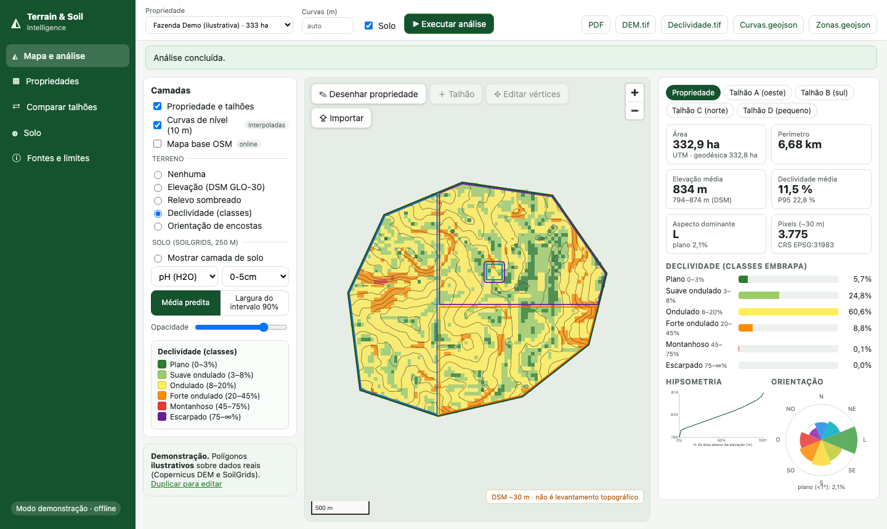
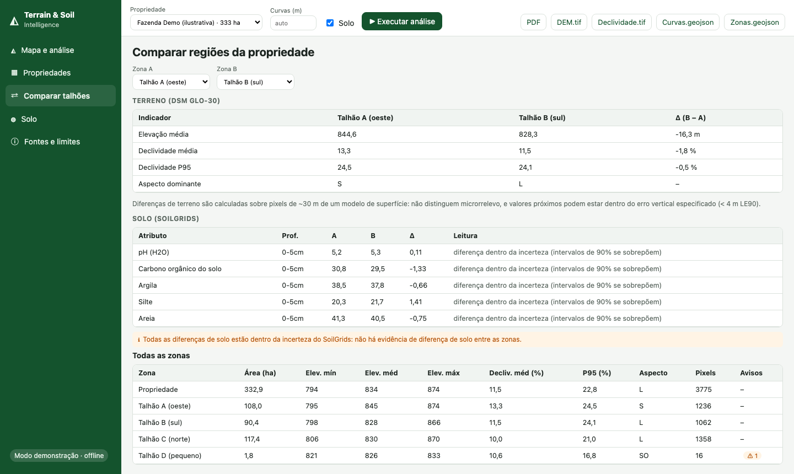

# 11 · Tutoriais passo a passo

## Tutorial 1 · Rodar a demonstração offline (sem internet)
```bash
python3.11 -m venv .venv && source .venv/bin/activate
pip install -r requirements-dev.txt
(cd frontend && npm install && npm run build)
cp .env.example .env                      # TSI_MODE=demo
cd backend && uvicorn app.main:app --port 8000 &   # API
cd ../frontend && npm run dev                      # http://localhost:5173
```
1. Abra `http://localhost:5173`. A faixa lateral diz **Modo demonstração · offline**.
2. Selecione **Fazenda Demo (ilustrativa)** e clique **▶ Executar análise**. A barra de progresso mostra as etapas (DEM → terreno → zonais → curvas → solo → arquivos). Leva ~1 s.
3. Veja a camada **Declividade (classes)**; troque para **Elevação**, **Relevo sombreado** e **Orientação de encostas**. A legenda e a opacidade ficam à esquerda; a escala, no mapa.
4. À direita, escolha **Talhão D (pequeno)**: aparece o aviso de "apenas 16 pixels".
5. Em **Solo**, escolha *Mostrar camada de solo* → *Argila* → *Largura do intervalo 90%*. Os pixels grandes são os de 250 m.



## Tutorial 2 · Importar o seu perímetro
1. **Importar** → escolha `.geojson`, `.kml` ou `.zip` (Shapefile com `.prj`).
2. A tabela mostra cada feição com **ok / reparada / recusada** e os problemas. Escolha qual é a **propriedade** e quais são **talhões**.
3. **Criar propriedade**. Arquivos de teste em `sample_data/`: `propriedade_demo.kml`, `propriedade_demo_shp.zip` (UTM 23S, será reprojetado), `invalido_gravata.geojson` (auto-interseção: reparada com aviso), `invalido_coordenadas_utm.geojson` (recusado), `invalido_talhoes_sobrepostos.geojson` (avisos de sobreposição).

> No modo demo só há DEM/solo para a região de Espírito Santo do Pinhal (SP). Fora dela a análise falha com a mensagem *"polígono fora do recorte de amostra"*. Use o modo live (tutorial 5).

## Tutorial 3 · Desenhar e editar
1. **✎ Desenhar propriedade** → clique para marcar vértices → **duplo clique** para concluir → dê um nome.
2. Com a propriedade selecionada: **＋ Talhão** para desenhar talhões; **✥ Editar vértices** para arrastar vértices e **Salvar**.
3. A propriedade de demonstração é somente leitura: use **Duplicar para editar**.
4. Depois de editar, **execute a análise de novo**: os resultados antigos pertencem à geometria antiga.

## Tutorial 4 · Comparar talhões e exportar
1. **Comparar talhões** → escolha duas zonas. Leia a coluna **Leitura** (dentro da incerteza / valores idênticos).
2. No topo, exporte **PDF**, **DEM.tif**, **Declividade.tif**, **Curvas.geojson**, **Zonas.geojson**.
3. Abra os GeoTIFF no QGIS: CRS EPSG:4326, `nodata = -9999`.



## Tutorial 5 · Modo live (dados reais para qualquer local do Brasil)
1. Em `.env`: `TSI_MODE=live`. Reinicie a API. Precisa de internet para `copernicus-dem-30m.s3.amazonaws.com` e `files.isric.org`.
2. A primeira análise de uma área baixa a janela do DEM (cache em `data/cache/`) e 60 camadas do SoilGrids (5 atributos × 3 profundidades × 4 estatísticas); leva dezenas de segundos.
3. Se o SoilGrids estiver indisponível, a análise **termina sem solo** e mostra o aviso (o relevo continua válido).

## Tutorial 6 · Docker Compose (PostGIS)
```bash
cp .env.example .env     # defina POSTGRES_PASSWORD
docker compose up --build
# http://localhost:8080
```
> **Não testado nesta máquina** (sem Docker). A sintaxe e as referências foram validadas por `python scripts/check_infra.py`. Se algo falhar no seu ambiente, `docs/pt-BR/12_testes_e_validacao.md` lista o que foi e o que não foi exercitado.

## Tutorial 7 · Usar só a biblioteca em Python
```python
import sys; sys.path.insert(0, "backend")
from pathlib import Path
from app.core.analysis import run_analysis
import json
gj = json.load(open("sample_data/propriedade_demo.geojson"))
prop = [f for f in gj["features"] if f["properties"]["kind"] == "property"][0]["geometry"]
res = run_analysis(prop, [], {}, Path("saida"), progress=lambda p, m: print(f"{p:.0%} {m}"), mode="demo")
print(res["zones"]["property"]["slope_pct"])
```

## Exercícios
1. Mude o intervalo das curvas para 5 m e depois 2 m. O que acontece e por quê (`07_...`)?
2. Em **Comparar**, compare Talhão C e D. Por que a leitura de solo diz "valores idênticos"?
3. Desenhe um talhão de 1 ha dentro da demonstração (duplicando-a). Quantos pixels de 30 m e de 250 m ele tem?
4. No notebook 01, mude a resolução agregada e explique a queda da declividade média.
5. Edite `scripts/make_sample_polygons.py` para criar um polígono em outra serra de SP e rode em modo live.
